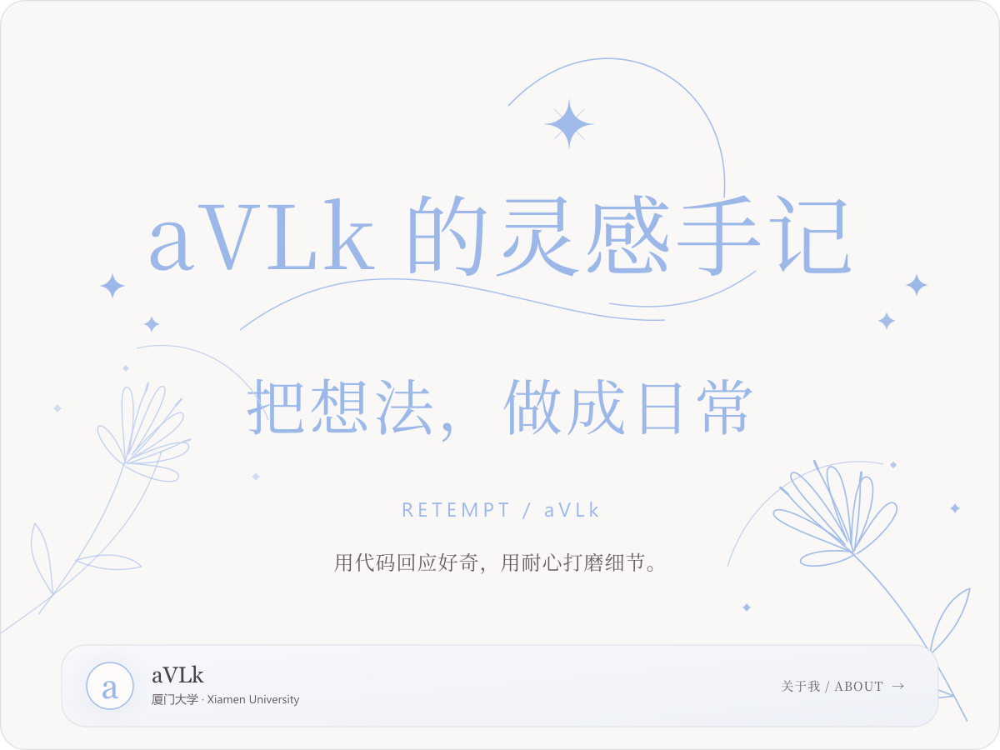

  <a href="#about">
    <picture>
      <source media="(max-width: 640px)" srcset="https://raw.githubusercontent.com/RETEMPT/RETEMPT/main/header-mobile.svg?v=6bb5b1d47c08" />
      
    </picture>
  </a>

 

<h3 align="center">✦ 关于我 / About</h3>

  <strong>aVLk</strong> &nbsp;·&nbsp; 厦门大学 / Xiamen University

  喜欢把想法做成易用、可靠的软件。 
  在 Web、HarmonyOS 与桌面应用开发中持续学习，关注交互细节与工程质量。

 

  <picture>
    <source media="(max-width: 640px)" srcset="https://raw.githubusercontent.com/RETEMPT/RETEMPT/main/focus-mobile.svg?v=6bb5b1d47c08" />
    
  </picture>

 

  <a href="mailto:1105786065@qq.com">Email</a> &nbsp;·&nbsp;
  <a href="https://github.com/RETEMPT">GitHub</a>

  把想法写进代码，把细节留给耐心。 
  © RETEMPT / aVLk

