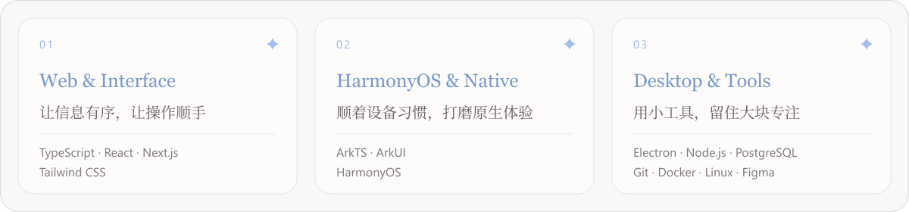

<h3 align="center">✦ 关于我 / About</h3>

  <strong>AVLk</strong> &nbsp;·&nbsp; 厦门大学 / Xiamen University

  在学习中积累，在实践中找到自己的节奏。 
  关注 Web、HarmonyOS 与桌面开发，喜欢清楚的表达、顺手的交互和经得起推敲的实现。

 

  <picture>
    <source media="(max-width: 640px)" srcset="https://raw.githubusercontent.com/RETEMPT/RETEMPT/main/focus-mobile.svg?v=9f8f3ac1b704" />
    
  </picture>

 

  <a href="mailto:youasobi108081@outlook.com">Email</a> &nbsp;·&nbsp;
  <a href="https://github.com/RETEMPT">GitHub</a>

